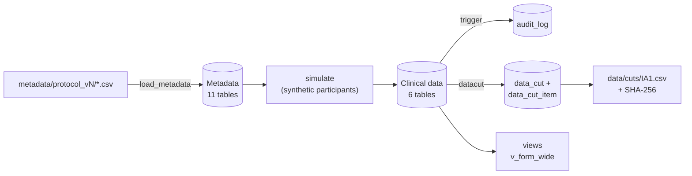

# adaptive-trial-db
# adaptive-trial-db

An amendment-resilient PostgreSQL database for a fictional adaptive platform trial.
**All data are synthetic. No real patient data are used anywhere in this repository.**

## The problem

Adaptive and platform trials change by design while they run: arms open and close at
interim analyses, allocation ratios change, and protocol modifications add or change
questions on case report forms (CRFs). If the database mirrors protocol version 1 (one
table per form, one column per question), every modification means altering live tables:
risky under GCP, breaks reports and exports, and blurs "missing" with "not asked yet".

## The approach: the protocol stored as data

Two layers in one database:

- **Metadata (11 tables) - the rule book.** Protocol versions, arms and when each is open
  (`arm_period`), visits, forms and form versions, questions and question versions
  (unit, valid range, required), and code lists of allowed answers.
- **Clinical data (6 tables) - the answers.** Sites, participants, randomisation, visits,
  completed forms, and `item_data`: one row per answer, each linked to the exact
  question version that collected it.

A protocol modification is a new folder of CSV files, loaded by the same program.
It only adds rows; no table ever changes shape.



Full entity-relationship diagram: [docs/erd.md](docs/erd.md)

## The fictional trial (DEMO-APT)

| Protocol version | Effective | Change | Randomised |
|---|---|---|---|
| v1 | 2026-01-05 | Arms A (usual care) and B, 1:1 | A 74, B 76 |
| v2 | 2026-04-01 | Modification 1: arm C added (1:1:1); CRP added to the Day 7 form (day7 v2.0) | A 19, B 18, C 19 |
| v3 | 2026-05-15 | Modification 2: arm B closed for futility at interim analysis 1 (simulated); A:C 1:1 | A 47, C 47 |

300 participants at 3 sites, 4,477 answers. Results after both modifications:

- **0** randomisations to arm B after it closed on 2026-05-15.
- Day 7: **144** forms on v1.0 (CRP not asked) and **144** on v2.0 (141 CRP answers).
- Table structure **identical** before and after: 80 columns in 17 tables
  ([docs/schema_before.txt](docs/schema_before.txt), [docs/schema_after.txt](docs/schema_after.txt)).

## Audit trail and reproducible data cuts

- **Audit trail** (`sql/03_audit.sql`): a trigger writes every insert, update and delete on
  `item_data` and `randomisation` to `audit_log` with the old row, new row, user, time and
  reason. Updates and deletes without a reason are refused, and `audit_log` is append-only.
  Corrections go through `python -m apt_db.correct` with a mandatory reason.
- **Interim data cut** (`sql/04_datacut.sql`, `src/apt_db/datacut.py`): `create IA1 2026-05-14`
  freezes a copy of the data to the cut-off date (2,936 rows), exports `data/cuts/IA1.csv`
  and stores its SHA-256 fingerprint. After five query-driven corrections to live data,
  `verify IA1` re-exports the frozen copy and the fingerprint is identical: the DMC's
  data can be reproduced exactly.

## Analysis views

`python -m apt_db.views` generates one wide view per form from the metadata
(`v_day7_wide` has columns sbp, spo2, ventilated, crp_mg_l). After a modification,
re-running it adds the new columns; the tables underneath do not change. The
`form_version` column separates "not asked under the old version" from "missing".

## Quick start (into an empty database)

```bash
docker compose up -d                                   # PostgreSQL 16 on localhost:5433
python3 -m venv .venv && source .venv/bin/activate
pip install -e .
for f in sql/0*.sql; do docker exec -i trialdb psql -U postgres -d trialdb -v ON_ERROR_STOP=1 < "$f"; done
python -m apt_db.load_metadata metadata/protocol_v1
python -m apt_db.simulate --n 150 --start 2026-01-05 --end 2026-03-31 --seed 2026
python -m apt_db.load_metadata metadata/protocol_v2
python -m apt_db.load_metadata metadata/protocol_v3
python -m apt_db.simulate --n 150 --start 2026-04-01 --end 2026-07-31 --seed 2027
python -m apt_db.datacut create IA1 2026-05-14
python -m apt_db.views
pytest -q
```

Fixed random seeds make every run produce the same data.

## Tests (`pytest -q`, 5 passed)

1. The modifications changed no table structure (all 17 tables match the snapshot).
2. Every answer belongs to a question on its own form version, and no v1.0 form has CRP.
3. Every randomisation used an arm that was open that day; none to arm B after it closed.
4. A change without a reason is refused; a change with a reason adds exactly one audit row.
5. Data cut IA1 is reproducible: stored, re-exported and file fingerprints match.

## Design decisions and trade-offs

| Decision | Alternative | Why | Cost and mitigation |
|---|---|---|---|
| Long `item_data` (one row per answer) | One wide table per form | Modifications become metadata rows; each answer stays tied to its question version | Harder to query: typed value columns, indexes, generated wide views |
| Typed columns (`value_num`, `value_text`, `value_date`) | One text column or JSONB | Ranges and dates checkable in SQL | One CHECK keeps at most one filled |
| Audit by database trigger | Logging in application code | Catches every change, whatever program makes it | Trigger code must be tested (test 4) |
| Frozen copy for data cuts | Re-query live data "as of" a date | Simple, provable reproducibility | Extra storage per cut |

## Limitations and what production would need

- One database login, so `changed_by` is always `postgres`. Production needs named users and
  role-based access (for example, blinded staff must not see arm allocation).
- Form versions are chosen by visit date. Real sites adopt a modification only after local
  approval, so production should track which version each site has activated.
- In practice the EDC (OpenClinica or REDCap) holds the data; this design shows the same ideas
  (events, CRF versions, items, response options) and how an export or ETL layer can stay stable.
- No formal computer-system validation, backups or access logging.

## How this was built

Built as hands-on interview preparation with help from an AI assistant (Claude).
Every step was run and its results checked on a local machine (Windows, WSL2, Docker).